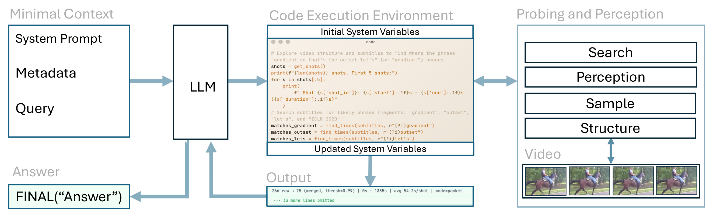
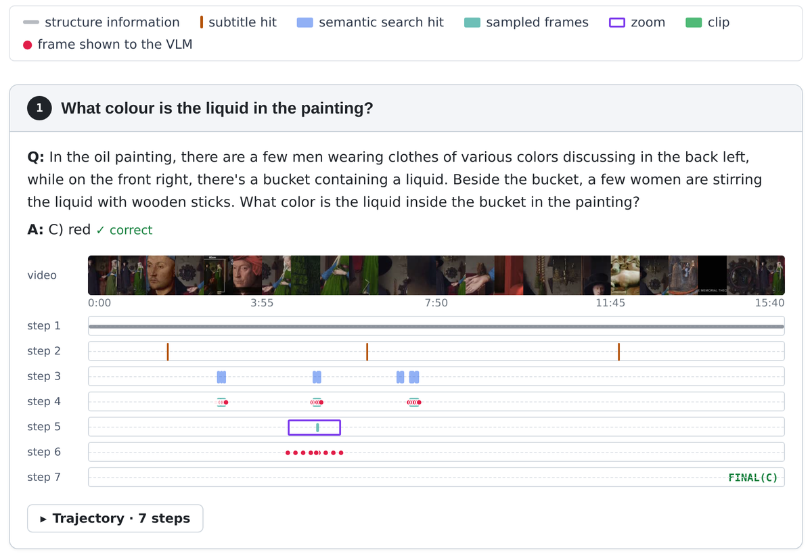

# HPP: Hierarchical Programmatic Probing for Long Video Understanding

**EMNLP 2026** · **[Project page](https://awaisrauf.com/HPP)** · **[Paper](https://arxiv.org/abs/2606.21734)** · **[Trajectories](https://awaisrauf.com/HPP/trajectories)**

TL;DR: Vision-language models perform fine-grained perception and multi-step temporal reasoning jointly in latent space, limiting their ability to plan and execute multi-step strategies over long videos. We show that decoupling the two and reformulating long video understanding as iterative programmatic probing of a hierarchically segmented video yields substantial improvements. With GPT-5-mini and Qwen3-VL-2B, HPP reaches 66.4% accuracy on LongVideoBench while using up to 16× fewer tokens than standard frame sampling. 

<p align="center"></p>
<p align="center"></p>

## Results

GPT-5-mini as the reasoning LLM, Qwen3-VL-2B as the perception VLM (accuracy, %):

| EgoSchema (subset) | LongVideoBench (val) | MLVU (dev, M-Avg) | Video-MME (w/ subs) |
|:---:|:---:|:---:|:---:|
| 70.4 | 66.4 | 69.3 | 71.8 |

## Install

```bash
git clone https://github.com/AwaisRauf/hpp && cd hpp
pip install -r requirements.txt
bash scripts/download_models.sh     # VideoCLIP-XL-v2 -> checkpoints/
cp .env.example .env                # add your OPENAI_API_KEY
```

Requires Python ≥ 3.10, `ffmpeg`, and a GPU with ~10 GB free.

**Note:** HPP runs the Python code the LLM writes, in-process and with your user's permissions
(the REPL is not a sandbox). Use a container or VM if that is a concern.

To check the install without an API key, replay one of the example trajectories (the LLM turns come from
the trace; everything else runs for real):

```bash
python tests/replay_trace.py examples/traces/needle-court_trace.json --video /data/MLVU/video/2_needle/needle_119.mp4
```

## Run

```bash
python run.py --video demo.mp4 --question "What does the chef add after the onions?" \
    --options "Garlic" "Tomatoes" "Salt" "Butter"
```

## Benchmarks

| Benchmark | Data |
|---|---|
| EgoSchema | [download](https://huggingface.co/datasets/lmms-lab/EgoSchema) |
| LongVideoBench | [download](https://huggingface.co/datasets/longvideobench/LongVideoBench) |
| Video-MME | [download](https://huggingface.co/datasets/lmms-lab/Video-MME) |
| MLVU | [download](https://huggingface.co/datasets/MLVU/MVLU) |

```bash
python eval.py --benchmark longvideobench --data /data/LongVideoBench
```

Results go to `runs/<benchmark>/`. See `python eval.py --help` for options.

## Visualize a trajectory

Every run writes a trace (each LLM turn, REPL execution, and VLM call). Turn traces into an interactive
page, with the frames the VLM saw re-extracted from the video:

```bash
python tools/export_trajectory.py traces/demo_trace.json --out viewer_data
cd viewer_data && python -m http.server    # open http://localhost:8000
```

`examples/traces/` holds the 10 trajectories shown on the [project page](https://awaisrauf.com/HPP/trajectories).

## Citation

```bibtex
@inproceedings{rauf2026hpp,
  title     = {HPP: Hierarchical Programmatic Probing for Long Video Understanding by Decoupling Perception and Reasoning},
  author    = {Rauf, Awais and Hassan, Ahmed and Slabaugh, Greg},
  booktitle = {Proceedings of the 2026 Conference on Empirical Methods in Natural Language Processing (EMNLP)},
  year      = {2026}
}
```

Builds on [rlm-minimal](https://github.com/alexzhang13/rlm-minimal) (MIT). Uses
[VideoCLIP-XL-v2](https://huggingface.co/alibaba-pai/VideoCLIP-XL-v2) (CC BY-NC-SA 4.0) and
[C-RADIO](https://github.com/NVlabs/RADIO); check their licenses before commercial use.
